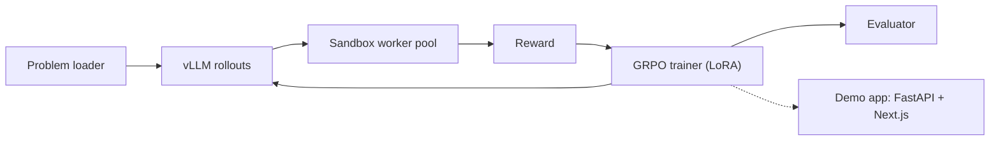
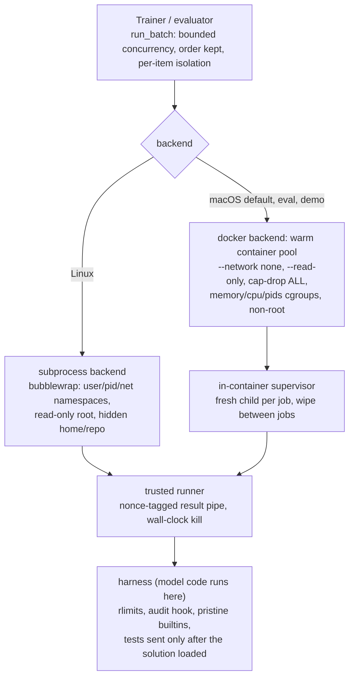

# CodeRL

**Self-improving coding agent via RL from execution feedback.** A small open code model
(Qwen2.5-Coder 0.5B/1.5B) is trained with GRPO (TRL + PEFT LoRA) on pass/fail signals from
running its own generated code in a secure sandbox against unit tests.

> 🚧 **Phase 2a — pass@k evaluation of the base models** (Phase 1a data pipeline and 1b secure sandbox done)

[](https://github.com/Varad2812/CodeRL/actions/workflows/ci.yml)

## Problem

Small code models are cheap to run but weak at getting programs *right*. Supervised
fine-tuning teaches style; it never tells the model whether its code actually works. Unit
tests do — and they are a free, verifiable reward signal.

## Approach

1. Sample several candidate solutions per problem from the model.
2. Execute each in an isolated sandbox against the problem's unit tests.
3. Turn results into rewards (fraction of tests passed) and update the policy with GRPO.
4. Evaluate on held-out benchmarks, with train/eval contamination explicitly controlled.

## Architecture



## Results

| Model            | HumanEval pass@1 | HumanEval pass@10 | MBPP-test pass@1 | MBPP-test pass@10 |
|------------------|------------------|-------------------|------------------|-------------------|
| Base             | TBD              | TBD               | TBD              | TBD               |
| Rejection-SFT    | TBD              | TBD               | TBD              | TBD               |
| GRPO             | TBD              | TBD               | TBD              | TBD               |

No numbers yet. The base-model rows come from the Kaggle run
([`docs/KAGGLE.md`](docs/KAGGLE.md)); `python -m coderl.eval.report results/` generates the table.

## Evaluation

| | |
|---|---|
| Benchmarks | HumanEval (164 problems), MBPP-test (500). Never trained on; see the contamination policy below. |
| Prompt | Chat template of the instruct model. Fixed system prompt asking for one ```` ```python ```` block. HumanEval: signature + docstring. MBPP: description + the first test assert. |
| Greedy | T = 0, n = 1 → **pass@1 (greedy)** |
| Sampled | T = 0.8, top_p = 0.95, **n = 20** per problem → **pass@1** and **pass@10** with the unbiased estimator of [Chen et al. 2021](https://arxiv.org/abs/2107.03374): `1 − C(n−c, k) / C(n, k)`, averaged over problems |
| Decoding | max 512 new tokens, no repetition penalty or top-k, fixed seeds (per-problem seed = seed + index) |
| Extraction | first ```` ```python ```` block (fallback: any fence, then raw text); main guards, asserts and example calls removed. For HumanEval, a body-only answer gets its signature back, and the prompt's imports/helpers are prepended (the official protocol runs prompt + completion). Every completion records its `extraction_status`. |
| Execution | sandbox, `eval` limit profile (6 s CPU, 12 s wall, 6 s per test, 256 MB). Correct = every test passes **and** no integrity flags (e.g. `custom_eq`). |
| Outputs | `results/<run>/<benchmark>/summary.json` (committed): metrics, error/timeout/extraction breakdowns, sandbox isolation level, git commit, package versions. `samples.jsonl.gz` holds every completion (not committed). |

```bash
make install-hf && make smoke-eval   # Mac: HF on MPS, 5 problems/benchmark, n=2, Docker sandbox
python -m coderl.eval.run_benchmarks --model Qwen/Qwen2.5-Coder-0.5B-Instruct --backend vllm \
    --benchmarks humaneval,mbpp_test --out results/base/qwen0.5b --dtype float16   # Linux GPU
python -m coderl.eval.report results/   # markdown table of every summary.json
```

The sandbox has two named limit profiles. `train` (2 s CPU / 4 s wall) is used for RL rewards and
`eval` for benchmarks. They can be overridden via YAML (`CODERL_SANDBOX_CONFIG`,
`profiles.<name>.<field>`) or env (`CODERL_SANDBOX_EVAL_CPU_SECONDS=8`). All 1,119 canonical
solutions pass under `eval`.

## Sandbox

Model-generated code is untrusted, and under RL the policy is *actively searching* for ways to
get reward without passing tests. The executor runs each solution in a fresh, resource-limited
interpreter behind three independent layers and fails closed: every test counts as failed
unless an authenticated per-test record says otherwise. Threat model, guarantees per backend
and known limitations: **[SECURITY.md](SECURITY.md)**.



```python
from coderl.sandbox import get_executor  # CODERL_SANDBOX_BACKEND=subprocess|docker

with get_executor() as ex:  # docker on macOS/Windows, subprocess on Linux
    res = ex.run(solution_code, problem)  # status, per-test results, num_passed, traceback
    batch = ex.run_batch([(code, problem), ...])
```

`tests/sandbox/test_security.py` attacks every backend (network, filesystem, secrets, fork and
memory bombs, infinite loops, `sys.exit`/`os._exit`, fake stdout JSON, forged result records,
redefined `AssertionError`/builtins/`math.isclose`, `atexit`, reading tests via `gc`, frames,
signal handlers and file descriptors) and runs the OS-level attacks a second time with the
in-process hardening disabled. All 1,119 canonical solutions run through both backends in CI
(100% under the `eval` limit profile; one reference solution needs ~2 s CPU and exceeds the `train` profile).

**Throughput** — all 500 MBPP-test canonical solutions (1,516 test cases), `make bench-sandbox`.
Measured on an **Apple M2 MacBook (8 cores) via Docker Desktop** (Linux VM, 8 vCPUs), so the
Docker numbers include the VM; the subprocess backend is Linux-only and not shown.

| Backend | Workers | Problems/s | Test cases/s | p50 latency | p95 latency |
|---------|--------:|-----------:|-------------:|------------:|------------:|
| docker  | 1 | 66.8 | 202.5 | 10.7 ms | 34.4 ms |
| docker  | 4 | 207.2 | 628.2 | 12.5 ms | 39.9 ms |
| docker  | 8 | 309.6 | 938.8 | 19.3 ms | 56.9 ms |

Raw results: [`results/sandbox_bench.json`](results/sandbox_bench.json).

## Data & contamination policy

- **Train** = MBPP `train` + `validation`. **Eval** = MBPP `test` + HumanEval (never trained on).
- Every train problem is compared to every eval problem: exact match on normalized prompts and
  canonical solutions, plus near-duplicates via MinHash LSH on word 5-gram shingles
  (Jaccard ≥ 0.8, configurable).
- Colliding **train** problems are removed and logged; eval sets are never modified.
- Output: `contamination_report.json` lists each offending pair with its similarity.
- The MBPP `prompt` split (few-shot examples) is not used for training.

## Quickstart

```bash
uv venv --python 3.11   # 3.10-3.13 supported
make install      # core + dev deps
make all          # lint + typecheck + tests
make data         # downloads MBPP/HumanEval, writes data/processed/*
make sandbox-image   # build the Docker sandbox image (also built on demand)
make test-fast       # everything except Docker tests;  make test-docker for those
make bench-sandbox   # throughput of each available backend -> results/sandbox_bench.json
```

On Linux, install `bubblewrap` (`apt install bubblewrap`) for full subprocess-backend isolation;
`uv run python -m coderl.sandbox info` shows what is available.

Optional extras: `--extra hf` (torch + transformers; Mac/CPU/CUDA), `--extra gen` (vLLM 0.18.1, Linux/CUDA only), `--extra train`, `--extra app`.

## Repo structure

```
coderl/
  data/       schema, loaders (mbpp, humaneval, apps stub), dedup, build CLI
  sandbox/    harness, runner, subprocess + docker backends, worker pool, metrics
  rewards/    (Phase 2) test-based rewards
  train/      (Phase 3) GRPO + LoRA
  eval/       prompts, code extraction, pass@k, benchmark runner, report
  gen/        generation backends: vLLM, Hugging Face, mock
  app/        (Phase 5) FastAPI backend
  utils/      structured logging, settings
docker/       sandbox image (sandbox.Dockerfile)
notebooks/    Kaggle notebook (base-model eval); docs/KAGGLE.md
scripts/      benchmarks
tests/        offline unit tests (no network); tests/sandbox = security suite
```

## Design decisions

- **One assert per test**, so reward can be the fraction of tests passed (denser than 0/1).
- **MBPP prompt includes the first assert** so the model knows the function name/signature.
- **HumanEval `check()` is split via `ast`**, with a logged whole-function fallback.
- **Light core dependencies**; training/generation/app deps are opt-in extras so CI stays fast.
- **Structured JSON logging** (structlog) everywhere; no `print()` in library code.

## License

MIT — see [LICENSE](LICENSE).
