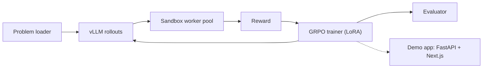

# CodeRL

**Self-improving coding agent via RL from execution feedback.** A small open code model
(Qwen2.5-Coder 0.5B/1.5B) is trained with GRPO (TRL + PEFT LoRA) on pass/fail signals from
running its own generated code in a secure sandbox against unit tests.

> 🚧 **Phase 1 — data pipeline**

[](https://github.com/Varad2812/CodeRL/actions/workflows/ci.yml)

## Problem

Small code models are cheap to run but weak at getting programs *right*. Supervised
fine-tuning teaches style; it never tells the model whether its code actually works. Unit
tests do — and they are a free, verifiable reward signal.

## Approach

1. Sample several candidate solutions per problem from the model.
2. Execute each in an isolated sandbox against the problem's unit tests.
3. Turn results into rewards (fraction of tests passed) and update the policy with GRPO.
4. Evaluate on held-out benchmarks, with train/eval contamination explicitly controlled.

## Architecture



## Results

| Model            | HumanEval pass@1 | HumanEval pass@10 | MBPP-test pass@1 | MBPP-test pass@10 |
|------------------|------------------|-------------------|------------------|-------------------|
| Base             | TBD              | TBD               | TBD              | TBD               |
| Rejection-SFT    | TBD              | TBD               | TBD              | TBD               |
| GRPO             | TBD              | TBD               | TBD              | TBD               |

No numbers yet — to be filled in after training and evaluation.

## Data & contamination policy

- **Train** = MBPP `train` + `validation`. **Eval** = MBPP `test` + HumanEval (never trained on).
- Every train problem is compared to every eval problem: exact match on normalized prompts and
  canonical solutions, plus near-duplicates via MinHash LSH on word 5-gram shingles
  (Jaccard ≥ 0.8, configurable).
- Colliding **train** problems are removed and logged; eval sets are never modified.
- Output: `contamination_report.json` lists each offending pair with its similarity.
- The MBPP `prompt` split (few-shot examples) is not used for training.

## Quickstart

```bash
uv venv --python 3.11
make install      # core + dev deps
make all          # lint + typecheck + tests
make data         # downloads MBPP/HumanEval, writes data/processed/*
```

Optional extras: `uv sync --extra train`, `--extra gen` (Linux/CUDA only), `--extra app`.

## Repo structure

```
coderl/
  data/       schema, loaders (mbpp, humaneval, apps stub), dedup, build CLI
  sandbox/    (Phase 2) isolated code execution
  rewards/    (Phase 2) test-based rewards
  train/      (Phase 3) GRPO + LoRA
  eval/       (Phase 4) pass@k evaluation
  app/        (Phase 5) FastAPI backend
  utils/      structured logging, settings
tests/        offline unit tests (no network)
```

## Design decisions

- **One assert per test**, so reward can be the fraction of tests passed (denser than 0/1).
- **MBPP prompt includes the first assert** so the model knows the function name/signature.
- **HumanEval `check()` is split via `ast`**, with a logged whole-function fallback.
- **Light core dependencies**; training/generation/app deps are opt-in extras so CI stays fast.
- **Structured JSON logging** (structlog) everywhere; no `print()` in library code.

## License

MIT — see [LICENSE](LICENSE).
